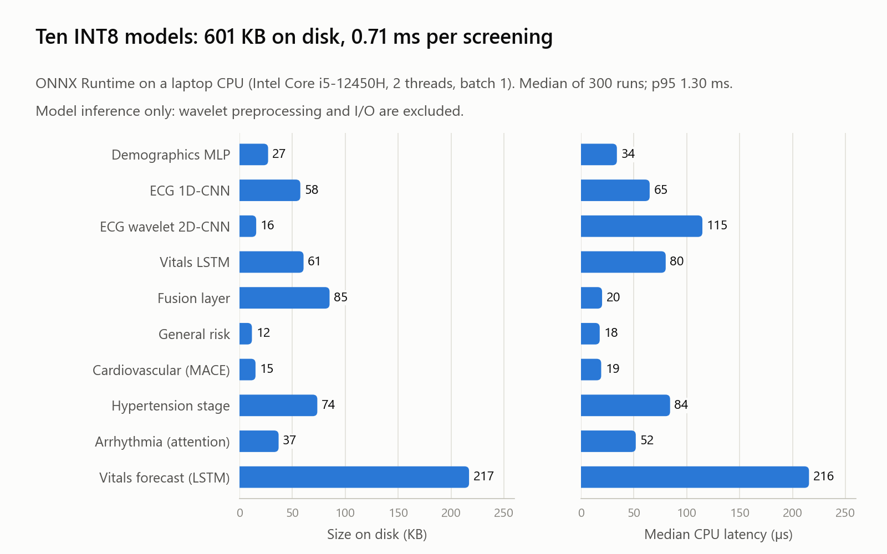
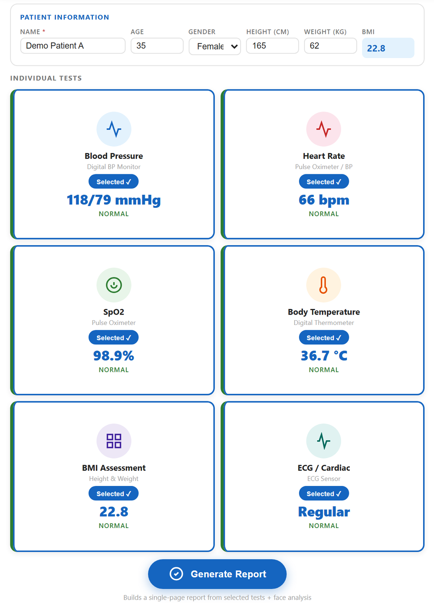
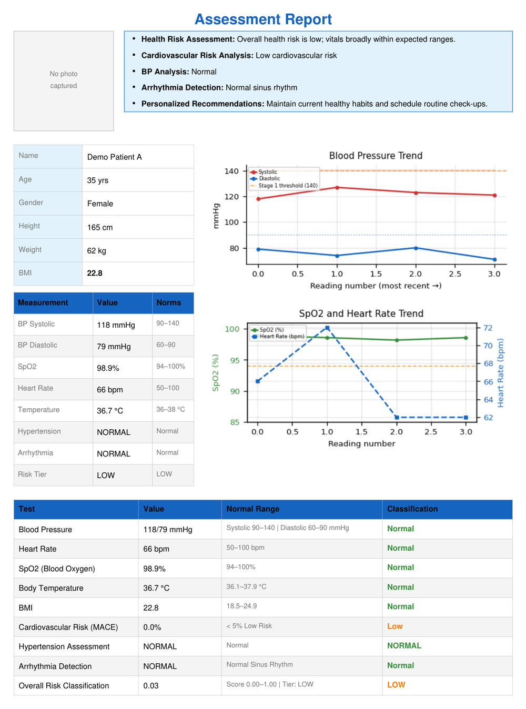
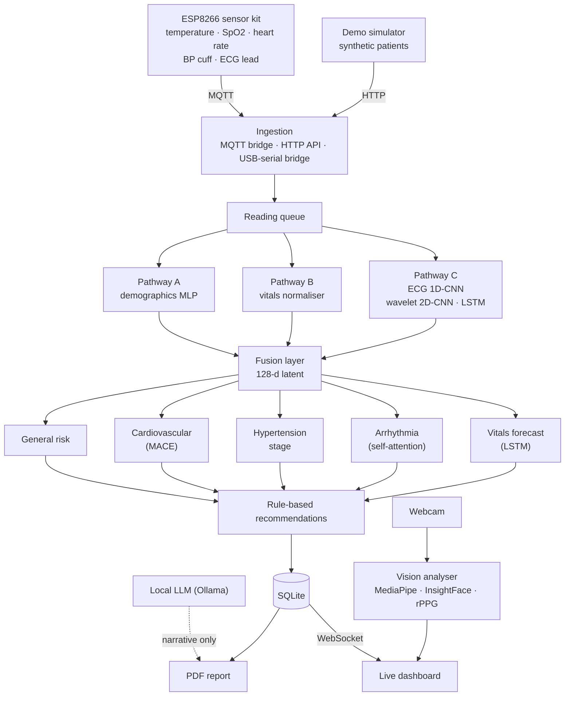
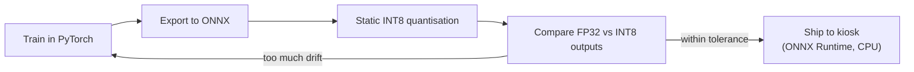

# Edge-AI Health Monitor

An offline health-screening kiosk: an IoT sensor kit streams vital signs to custom PyTorch models running on a CPU, which produce a risk assessment, live dashboard and printable report. No cloud and no internet are needed.

> **Note:** The source code is private. This repository documents the architecture, model design and results. I'm happy to walk through the implementation in an interview.

<picture>
  <source media="(prefers-color-scheme: dark)" srcset="assets/models-dark.png">
  
</picture>

---

## Overview

Basic health screening (blood pressure, SpO2, heart rate, temperature, ECG) is cheap to measure but hard to interpret without a clinician, and many screening sites have unreliable internet. Sending patient data to the cloud also raises privacy concerns.

This project combines a low-cost sensor kit with an AI pipeline that runs entirely on local hardware. Readings from four sensors are encoded by three specialised neural networks, fused into one shared representation and passed to five risk-assessment models. The result is shown live on a dashboard and saved as a one-page PDF report. Patient data never leaves the device.

## Key Features

- **Live vitals dashboard** with per-sensor test cards and a real-time ECG waveform.
- **Five AI risk modules:** general health risk, cardiovascular event risk (MACE), hypertension staging, arrhythmia classification and a short-term vitals forecast.
- **Contactless vision analysis (optional):** a 12-second webcam scan estimates heart rate with remote photoplethysmography (rPPG) and measures stress, blink rate and pallor indicators.
- **Automated PDF report** with vitals, trend charts, the ECG trace and a plain-language summary written by a local LLM. The LLM can only phrase facts the models already computed, and a rule-based fallback takes over if it's unavailable.
- **Remote device management:** live device status, event log, and Wi-Fi reconfiguration over MQTT without re-flashing the firmware.
- **Demo mode without hardware:** a built-in simulator streams three synthetic patients (normal, high-risk and arrhythmia), and readings can also arrive over HTTP or a USB-serial bridge.
- **Patient isolation:** each screening is its own session, so one patient's data never leaks into the next.

## Screenshots

| | |
|---|---|
|  |  |
| *Screening dashboard with a synthetic demo patient* | *The generated one-page report* |

## Architecture

## How It Works

1. The ESP8266 firmware reads four sensors and publishes the readings over MQTT. The same pipeline also accepts readings over HTTP and from a USB-serial bridge.
2. A bridge service queues the readings and passes them to the AI engine.
3. Three encoders process different signal types: an MLP for demographics, a statistical normaliser for vitals, and a CNN + wavelet-scalogram CNN + LSTM stack for the ECG.
4. A fusion layer combines the three into a single 128-dimensional representation.
5. Five task-specific models score risk, cardiovascular events, hypertension stage, arrhythmia and the short-term forecast, and a rule-based layer turns the scores into recommendations.
6. Results are saved, pushed live to the dashboard over WebSocket, and compiled into a PDF report.

## Model and Deployment Pipeline

All 10 models go through the same pipeline. Each quantised model is checked numerically against its FP32 original before it ships, so the speed gains from quantisation never silently cost accuracy.

## Results

| Metric | Value |
|---|---|
| Models in the pipeline | 10, all INT8-quantised ONNX |
| Total size of all 10 models | 601 KB |
| Model inference per screening | 0.71 ms median, 1.30 ms p95 (300 runs) |
| Hardware | Laptop CPU (Intel Core i5-12450H), 2 threads, no GPU |

Inference time covers all ten models for one screening at batch size 1. Wavelet preprocessing and I/O are not included.

> The models are currently trained on synthetic physiological data. The architecture and deployment pipeline are complete; clinical accuracy has not been validated on real patient data, and this is not a medical device.

## Tech Stack

| Category | Tools |
|---|---|
| Deep learning | PyTorch (MLP, 1D-CNN, 2D-CNN on wavelet scalograms, LSTM, self-attention, fusion layer) |
| Edge inference | ONNX Runtime, static INT8 quantisation |
| Computer vision | MediaPipe FaceMesh, InsightFace, OpenCV, rPPG (forehead green-channel FFT) |
| LLM | Ollama (Gemma 3 1B), constrained to narrating computed results |
| Backend | FastAPI, WebSockets, SQLite (WAL mode) |
| IoT | ESP8266 firmware (C++), MQTT, HTTP and USB-serial ingestion, MLX90614, MAX30102, BP cuff, ECG front end |
| Frontend | HTML, CSS, JavaScript, Chart.js |
| Reports | ReportLab |

## Engineering Decisions

- **Separate encoders per signal type instead of one large model:** an ECG waveform, a blood-pressure number and a patient's age need different architectures. Separate pathways make each part easier to debug and explain.
- **LLM for wording only:** in a health context, a hallucinated finding is dangerous. The local LLM receives only results that were already computed and is instructed to rephrase them, and a deterministic template takes over if it fails.
- **Small thread budget:** each ONNX Runtime session uses two threads, so the whole pipeline stays light on a kiosk CPU that also runs the dashboard and vision analysis.
- **Fully offline:** no internet dependency means the kiosk keeps working on site, and no patient data leaves the device.

## My Role

I designed and built the system end to end: the PyTorch model architectures, the training, export and quantisation pipeline, the FastAPI backend and live dashboard, the vision analyser, the ESP8266 firmware and MQTT protocol, and the constrained LLM report layer.

## Contact

**Zayed Makandar** | [zayedmakandar03@gmail.com](mailto:zayedmakandar03@gmail.com) | [LinkedIn](https://www.linkedin.com/in/zayed-makandar-642536422/) | [Portfolio](https://zayedmakandar.com)
